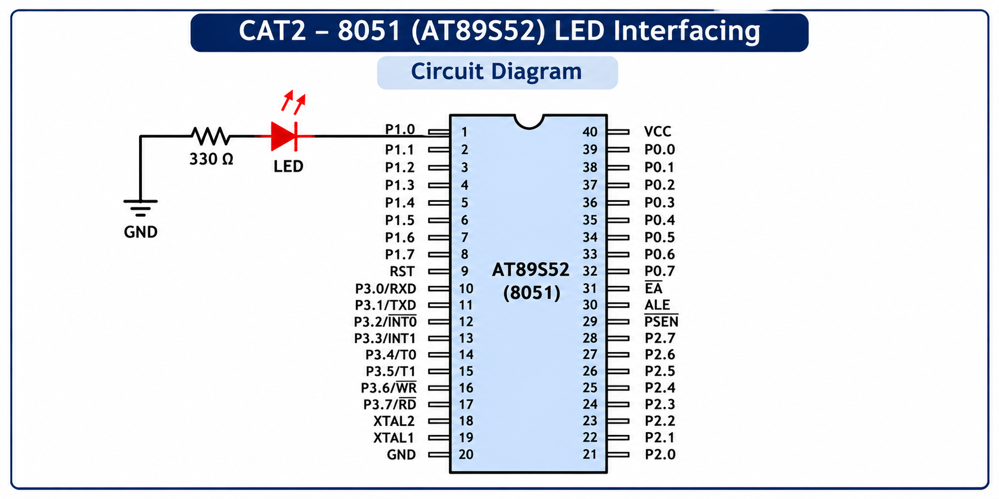

# CAT2 — 8051 Toolchain Setup and LED Blink

## Overview

This assignment introduces the AT89S52 project toolchain and toggles an LED on port pin P1.0. The source uses a software delay between output changes.

## Objectives

- Inspect and build an AT89S52 project in Keil.
- Control a GPIO pin using the 8051 register definitions.
- Implement a reusable, loop-based delay.

## Hardware Requirements

- AT89S52 development board (identified in the original assignment notes)
- LED output assigned to `P1.0` by the source
- Board power and programming hardware; exact programmer details are not recorded

## Software Requirements

- Keil µVision with the C51 toolchain
- The project targets the AT89S52. Its project clock setting is 33 MHz, while the delay source comment assumes an 11.0592 MHz crystal; verify the actual board clock before relying on delay timing.

## Project Structure

```text
CAT2/
├── README.md
├── STARTUP.A51
├── circuit.png
├── week2.uvproj
├── week2_l.c
└── Objects/
    ├── README.md
    └── week2.hex
```

- `week2_l.c` contains the LED output and software delay.
- `week2.uvproj` is the Keil project; it includes `week2_l.c` and `STARTUP.A51`.
- `STARTUP.A51` supplies the 8051 startup code.
- `Objects/week2.hex` is the existing build output.
- `Objects/README.md` is present but empty.

## Circuit Diagram



## Implementation

The program declares `LED` as `P1^0`. `delay_ms()` runs nested software loops, and `main()` repeatedly complements the pin state then calls `delay_ms(500)`. The source comment describes the delay-loop calibration as approximate and based on an 11.0592 MHz crystal.

## Working Principle

1. The main loop complements the `P1.0` output.
2. The processor executes the software delay loop.
3. The sequence repeats continuously.

## Output / Results

The intended output is a continuously toggling LED on `P1.0`. The actual blink interval depends on the processor clock and compiler; the project clock setting and source timing comment differ. No output screenshot is present.

## Conclusion

The program demonstrates basic AT89S52 GPIO control and a software-generated delay. Its timing should be checked against the actual board clock.
