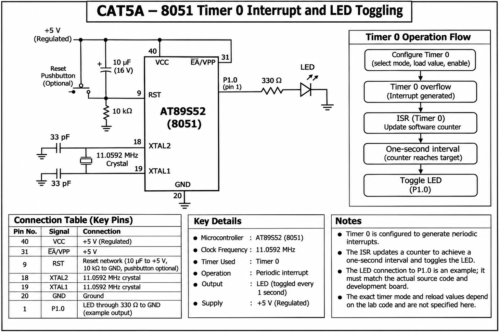

# CAT5A — Timer 0 Interrupt LED Toggle

## Overview

This AT89S52 program uses Timer 0 interrupts to maintain a millisecond counter and toggle an LED after each 1,000 timer interrupts.

## Objectives

- Configure Timer 0 in 16-bit Mode 1.
- Enable and service a timer interrupt.
- Use an interrupt counter to schedule an LED state change.

## Hardware Requirements

- AT89S52 microcontroller
- LED assigned to `P1.0`
- The source timer preload is calculated for an 11.0592 MHz crystal.

## Software Requirements

- Keil µVision with the C51 toolchain
- `TASK5A.uvproj` declares a 33 MHz project clock, while the source preload comment assumes 11.0592 MHz. Verify the actual clock before relying on the one-second interval.

## Project Structure

```text
CAT5A/
├── README.md
├── STARTUP.A51
├── TASK5A.uvproj
├── circuit.png
├── main.c
└── Objects/
    ├── README.md
    └── TASK5A.hex
```

- `main.c` configures Timer 0 and handles the interrupt.
- `TASK5A.uvproj` includes `main.c` and `STARTUP.A51`.
- `Objects/TASK5A.hex` is the existing build output; `Objects/README.md` is present but empty.

## Circuit Diagram



## Implementation

`timer0_init()` selects Timer 0 Mode 1, loads `TH0`/`TL0` with `0xFC66`, enables `ET0` and `EA`, and starts the timer. The Timer 0 ISR reloads the timer and increments `ms_ticks`. When the counter reaches 1,000, it resets the counter and complements the LED on `P1.0`. The source comments derive the preload for an approximately 1 ms tick at 11.0592 MHz.

## Working Principle

1. Set the LED low and start Timer 0.
2. On each overflow, reload the timer and increment the tick count.
3. After 1,000 interrupts, toggle the LED and clear the count.
4. Repeat while the foreground loop remains idle.

## Output / Results

The intended output is a periodic LED toggle, approximately once per second under the source's assumed clock and timing. Actual timing depends on the board clock and compiler. No output screenshot is present.

## Conclusion

The experiment demonstrates timer-driven LED control using a periodic interrupt rather than a foreground delay loop.
