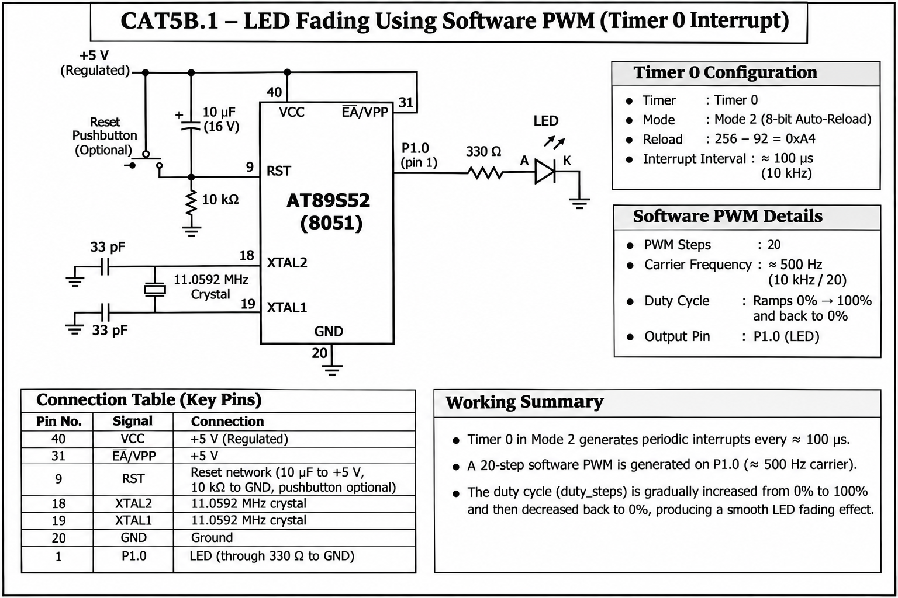

# CAT5B.1 — LED Fading with Timer-Driven Software PWM

## Overview

This AT89S52 program generates software PWM on `P1.0`. The interrupt routine varies the duty cycle to fade the LED up and down.

## Objectives

- Configure Timer 0 in 8-bit auto-reload Mode 2.
- Generate a periodic interrupt for software PWM.
- Change PWM duty cycle to vary LED brightness.

## Hardware Requirements

- AT89S52 microcontroller with an 11.0592 MHz clock assumed by the source timing calculations
- LED on `P1.0`, with the 330 Ω series resistor specified in the existing assignment notes

## Software Requirements

- Keil µVision with the C51 toolchain
- `TASK5B_1.uvproj` declares a 33 MHz project clock, while the source calculates its timer reload for 11.0592 MHz. Verify the actual clock before relying on the stated PWM and fade rates.

## Project Structure

```text
CAT5B.1/
├── README.md
├── STARTUP.A51
├── TASK5B_1.uvproj
├── circuit.png
├── main.c
└── Objects/
    ├── README.md
    └── TASK5B_1.hex
```

- `main.c` contains the Timer 0 ISR and PWM/fade logic.
- `TASK5B_1.uvproj` includes `main.c` and `STARTUP.A51`.
- `Objects/TASK5B_1.hex` is the existing build output; `Objects/README.md` is present but empty.

## Circuit Diagram



## Implementation

Timer 0 Mode 2 reloads from `256 - 92`, chosen for an approximately 100 µs interrupt at 11.0592 MHz. The ISR advances a 20-step PWM counter and drives `P1.0` high while `pwm_tick < duty_steps`. A second counter changes `duty_steps` every 500 interrupts, increasing it to 20 and then decreasing it to 0.

## Working Principle

1. Initialize the LED low and start Timer 0.
2. Each interrupt updates the PWM phase and LED output.
3. Every 500 interrupts, adjust the duty cycle by one step.
4. Reverse the fade direction at the endpoints and repeat.

## Output / Results

The intended output is a gradual LED fade from dim/off to bright and back. The source describes an approximately 500 Hz PWM carrier and 50 ms duty updates at its assumed clock; these timings are not guaranteed with the project clock setting. No output screenshot is present.

## Conclusion

The program demonstrates interrupt-driven software PWM and duty-cycle control for LED brightness.
