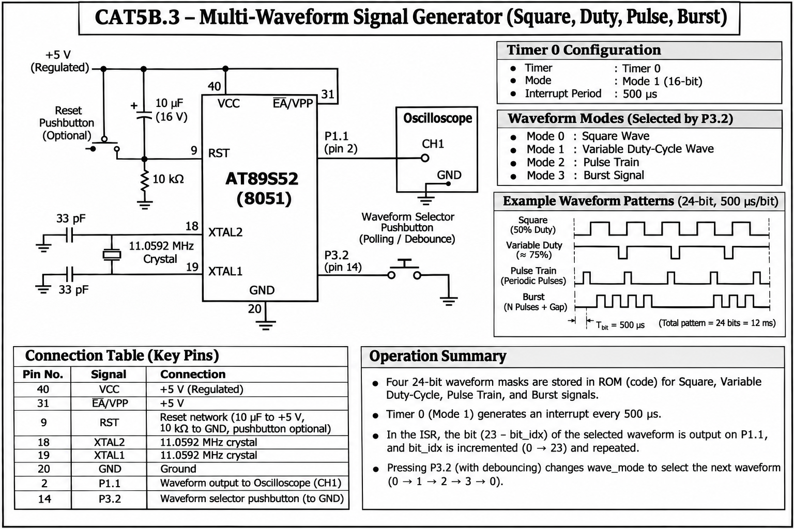

# CAT5B.3 — Timer-Driven Multi-Pattern Signal Generator

## Overview

This AT89S52 program serializes one of four 24-bit patterns onto `P1.1` at timer intervals. A push-button selects the pattern.

## Objectives

- Use Timer 0 interrupts to set a repeatable output bit interval.
- Store digital patterns in code memory and output them one bit at a time.
- Select the active pattern with a push-button.

## Hardware Requirements

- AT89S52 microcontroller with an 11.0592 MHz clock assumed by the source timing calculations
- Push-button input on `P3.2`
- Signal output on `P1.1`
- Oscilloscope or equivalent instrument to observe the output (as listed in the existing assignment notes)

## Software Requirements

- Keil µVision with the C51 toolchain
- `TASK5B_3.uvproj` declares a 33 MHz project clock, while the timer reload is calculated for 11.0592 MHz. Verify the actual clock before relying on signal timing.

## Project Structure

```text
CAT5B.3/
├── README.md
├── STARTUP.A51
├── TASK5B_3.uvproj
├── circuit.png
├── main.c
└── Objects/
    ├── README.md
    └── TASK5B_3.hex
```

- `main.c` defines the patterns, timer ISR, and mode-selection logic.
- `TASK5B_3.uvproj` includes `main.c` and `STARTUP.A51`.
- `Objects/TASK5B_3.hex` is the existing build output; `Objects/README.md` is present but empty.

## Circuit Diagram



## Implementation

`waveforms[]` stores four 24-bit masks: alternating bits (`0xAAAAAA`), four-on/four-off groups (`0xF0F0F0`), a pulse pattern (`0x802008`), and a burst pattern (`0xAA00AA`). Timer 0 is reloaded with `0xFE33`; each ISR writes the next mask bit, most-significant bit first, to `P1.1`. A debounced active-low press on `P3.2` advances the pattern and restarts its bit index.

## Working Principle

1. Initialize Timer 0 and the signal and button pins.
2. On each timer interrupt, output the current bit of the selected mask.
3. Advance the bit index and wrap it after 24 bits.
4. On a button press, select the next mask and restart at its first bit.
5. Repeat the selected pattern continuously.

## Output / Results

The intended output is a repeating digital waveform corresponding to the selected mask. The source uses a nominal 500 µs bit slot at 11.0592 MHz; actual timing depends on clock configuration and interrupt overhead. No oscilloscope screenshot is present.

## Conclusion

The program demonstrates timer-paced digital pattern generation and simple button-based mode selection on a single output pin.
