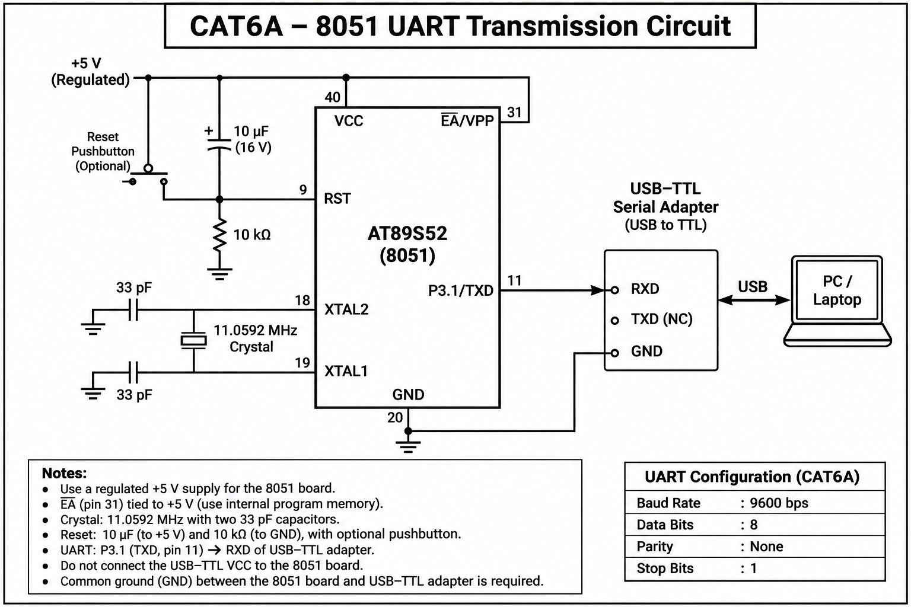

# CAT6A — UART Message Transmission

## Overview

This AT89S52 program configures the serial port and repeatedly transmits `Hello from 8051` followed by a carriage return and line feed.

## Objectives

- Configure the 8051 UART for asynchronous serial transmission.
- Generate the baud rate using Timer 1.
- Transmit a string to a serial terminal.

## Hardware Requirements

- AT89S52 microcontroller
- USB-to-TTL serial adapter
- PC with a serial terminal
- UART transmit output `P3.1` connected to adapter RX and a shared ground

The source does not use UART receive.

## Software Requirements

- Keil µVision with the C51 toolchain
- Serial terminal configured for 9600 baud, 8 data bits, no parity, and 1 stop bit
- The source assumes an 11.0592 MHz clock for the 9600 baud setting. The project declares a 33 MHz clock; verify the physical clock before relying on the baud rate.

## Project Structure

```text
CAT6A/
├── README.md
├── STARTUP.A51
├── TASK6A.uvproj
├── circuit.png
├── main.c
└── Objects/
    ├── README.md
    └── TASK6A.hex
```

- `main.c` configures UART transmission and sends the message.
- `TASK6A.uvproj` includes `main.c` and `STARTUP.A51`.
- `Objects/TASK6A.hex` is the existing build output; `Objects/README.md` is present but empty.

## Circuit Diagram



## Implementation

`uart_init()` sets Timer 1 to Mode 2, loads `TH1` and `TL1` with `0xFD`, sets `SCON` to `0x50` (serial Mode 1 with reception enabled), and starts Timer 1. `uart_tx_char()` writes to `SBUF` and waits for `TI`; `uart_tx_string()` sends a null-terminated string. The main loop sends the message and waits approximately one second using a software delay.

## Working Principle

1. Configure Timer 1 and the UART.
2. Send each character through `SBUF`, waiting for transmission completion.
3. Send carriage return and line feed.
4. Wait, then repeat the message.

## Output / Results

The intended terminal output is a recurring `Hello from 8051` line. The baud rate and delay depend on the actual clock and compiler; no terminal screenshot is present.

## Conclusion

The program demonstrates UART configuration and polling-based string transmission from an AT89S52 to a serial terminal.
