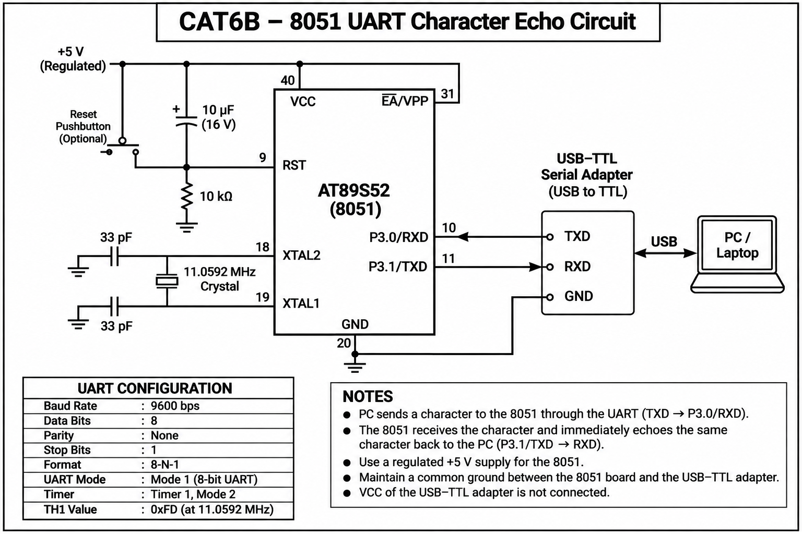

# CAT6B — Interrupt-Driven UART Character Echo

## Overview

This AT89S52 program receives serial characters in a UART interrupt handler, places them in a small ring buffer, and transmits them back to the sender.

## Objectives

- Configure the UART for asynchronous serial communication.
- Handle receive and transmit-complete events using the serial interrupt.
- Buffer received characters for foreground processing.

## Hardware Requirements

- AT89S52 microcontroller
- USB-to-TTL serial adapter and PC terminal
- `P3.0`/RXD connected to adapter TXD
- `P3.1`/TXD connected to adapter RXD
- Shared ground between the board and adapter

## Software Requirements

- Keil µVision with the C51 toolchain
- Serial terminal configured for 9600 baud, 8 data bits, no parity, and 1 stop bit
- The UART reload assumes an 11.0592 MHz clock; `TASK6B.uvproj` declares 33 MHz. Verify the physical clock and terminal baud compatibility.

## Project Structure

```text
CAT6B/
├── README.md
├── STARTUP.A51
├── TASK6B.uvproj
├── circuit.png
├── main.c
└── Objects/
    └── TASK6B.hex
```

- `main.c` implements UART initialization, the interrupt handler, the receive ring buffer, and echo transmission.
- `TASK6B.uvproj` includes `main.c` and `STARTUP.A51`.
- `Objects/TASK6B.hex` is the existing build output.

## Circuit Diagram



## Implementation

`uart_init()` configures Timer 1 Mode 2, loads `0xFD` for the intended 9600 baud at 11.0592 MHz, enables UART reception, and enables the serial and global interrupts. The interrupt handler reads `SBUF` when `RI` is set and queues the character if the 32-slot ring buffer has room; one slot is reserved to distinguish full from empty. When `TI` is set, the handler clears it and releases the transmitter. The main loop removes queued characters and sends them back. New input is discarded if the buffer is full.

## Working Principle

1. Initialize UART and enable serial interrupts.
2. On receive, read the character and enqueue it if space is available.
3. In the main loop, dequeue pending characters and start transmission.
4. On transmit completion, clear the flag so the next character can be sent.
5. Repeat to echo incoming serial data.

## Output / Results

The intended result is that typed characters are echoed back to the serial terminal. If the receive buffer fills, additional characters are dropped without a displayed error. No terminal screenshot is present.

## Conclusion

The experiment demonstrates interrupt-driven UART receive/transmit handling and a ring buffer for decoupling serial reception from foreground processing.
