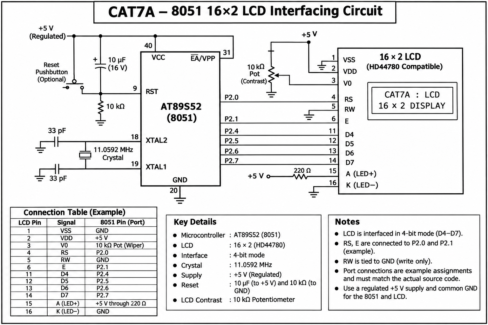

# CAT7A — 4-Bit 16×2 LCD Initialization and Text

## Overview

This AT89S52 program initializes an HD44780-compatible 16×2 LCD in 4-bit mode and displays text on both rows.

## Objectives

- Initialize an LCD in 4-bit, two-line mode.
- Separate LCD command and character-data writes.
- Display strings on both LCD rows.

## Hardware Requirements

- AT89S52 microcontroller
- HD44780-compatible 16×2 LCD
- LCD data lines assigned to `P2.4`–`P2.7`
- Register select on `P2.0` and enable on `P2.1`

The source does not control an LCD read/write pin; its external connection is not specified here.

## Software Requirements

- Keil µVision with the C51 toolchain
- The project declares a 33 MHz clock. Delay loops are software-based and are not calibrated to a stated LCD timing reference.

## Project Structure

```text
CAT7A/
├── README.md
├── STARTUP.A51
├── TASK7A.uvproj
├── circuit.png
├── lcd.c
├── lcd.h
├── main.c
└── Objects/
    ├── README.md
    └── TASK7A.hex
```

- `lcd.c` implements LCD initialization, command/data writes, nibble transfers, and string output.
- `lcd.h` declares the LCD functions.
- `main.c` writes the two display lines.
- `TASK7A.uvproj` includes `lcd.c`, `main.c`, and `STARTUP.A51`.
- `Objects/TASK7A.hex` is the existing build output; `Objects/README.md` is present but empty.

## Circuit Diagram



## Implementation

The LCD driver places each 4-bit nibble on the upper half of Port 2 and pulses `P2.1`; `P2.0` selects command or data mode. `lcd_init()` sends the 4-bit initialization sequence, configures two display lines, turns the display on with the cursor off, selects incrementing entry mode, and clears the display. `main()` displays `AT89S52 4-Bit` on row 1 and `16x2 LCD Ready!` on row 2.

## Working Principle

1. Wait for LCD power-up, then send the initialization nibbles.
2. Set the LCD to 4-bit, two-line operation.
3. Send a row-position command.
4. Write the row's characters as data nibbles.
5. Repeat for the second row, then leave the display unchanged.

## Output / Results

The intended display is:

```text
AT89S52 4-Bit
16x2 LCD Ready!
```

No output screenshot is present.

## Conclusion

The program demonstrates 4-bit LCD initialization and command/data handling for displaying text on a 16×2 module.
