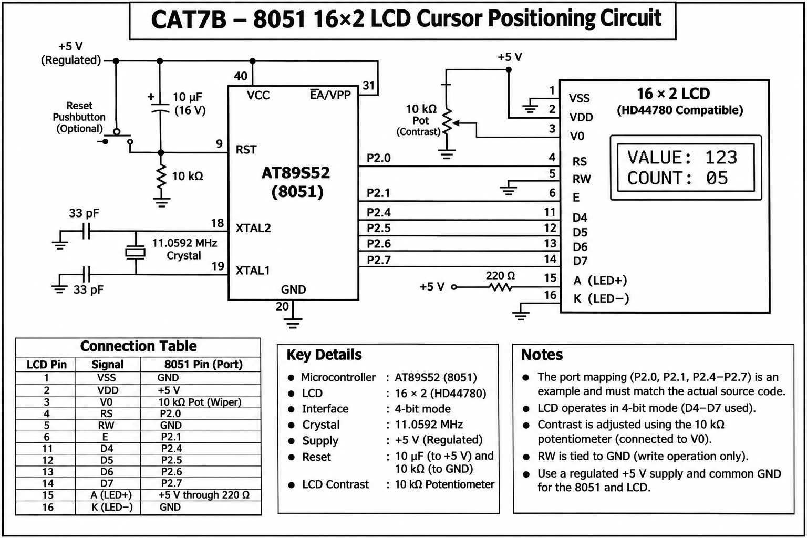

# CAT7B — LCD Cursor Positioning and Counter

## Overview

This AT89S52 program uses a 4-bit LCD driver to position text on a 16×2 display and update a decimal counter every half-second delay-loop interval.

## Objectives

- Position the LCD cursor by row and column.
- Display strings and unsigned integer values.
- Refresh a changing counter on the second row.

## Hardware Requirements

- AT89S52 microcontroller
- HD44780-compatible 16×2 LCD
- LCD data lines assigned to `P2.4`–`P2.7`
- Register select on `P2.0` and enable on `P2.1`

The source does not control an LCD read/write pin; its external connection is not specified here.

## Software Requirements

- Keil µVision with the C51 toolchain
- The project declares a 33 MHz clock. Software delay timing depends on the actual clock and compiler.

## Project Structure

```text
CAT7B/
├── README.md
├── STARTUP.A51
├── TASK7B.uvproj
├── circuit.png
├── lcd.c
├── lcd.h
├── main.c
└── Objects/
    ├── README.md
    └── TASK7B.hex
```

- `lcd.c` implements initialization, cursor positioning, text, and integer output.
- `lcd.h` declares the LCD functions.
- `main.c` displays a heading and repeatedly updates the counter.
- `TASK7B.uvproj` includes `lcd.c`, `main.c`, and `STARTUP.A51`.
- `Objects/TASK7B.hex` is the existing build output; `Objects/README.md` is present but empty.

## Circuit Diagram



## Implementation

The LCD data nibble is written on `P2.4`–`P2.7`, with `P2.0` as RS and `P2.1` as enable. `lcd_goto()` selects the first or second row and masks the column to 0–15. `lcd_print_number()` converts an unsigned integer to decimal using a local digit buffer. The main loop writes `AT89S52 Counter:` on row 1 and `Value: <counter>` on row 2, increments the unsigned counter, and calls a nested-loop delay.

## Working Principle

1. Initialize the LCD and write the fixed heading to row 1.
2. Position the cursor at the start of row 2.
3. Write the current counter value and spaces to overwrite prior digits.
4. Increment the counter and delay.
5. Repeat; the unsigned counter wraps according to its C51 integer width.

## Output / Results

The intended display is a heading and a continuously increasing decimal value, refreshed after each software delay. The delay is not a verified half-second across clock/compiler settings. No output screenshot is present.

## Conclusion

The program demonstrates LCD cursor addressing, integer-to-decimal output, and periodic display updates.
